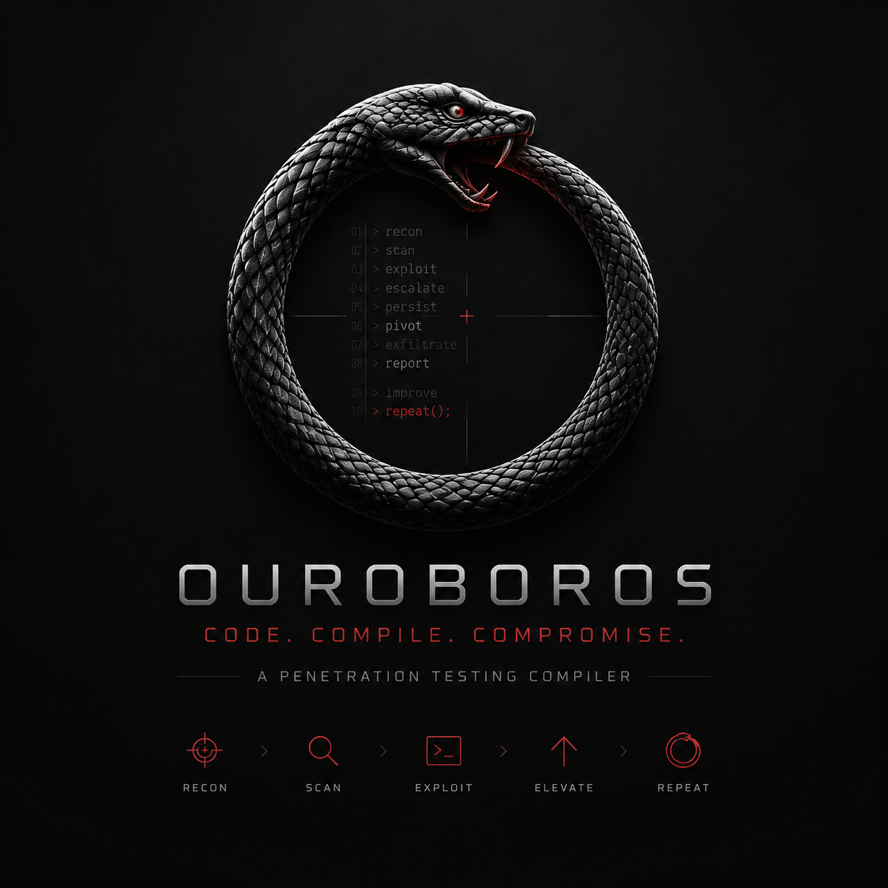

<p align="center">
  
</p>

# Ouroboros

Ouroboros is a TUI-first penetration testing IDE and compiler for authorized security work. It turns scoped objectives into auditable plans, toolchain actions, runtime worker state, replayable evidence, and operator-controlled execution gates.

## Current Shape

- Goal-driven architecture with domain packs for Web/API, Infra/Internal, and CTF/Lab work.
- Native Go CLI under `cmd/ouro/` with first-party packages under `internal/`.
- Bubble Tea TUI surfaces toolchain health, agent runtime, replay timelines, evidence graph state, and read-only inspector details.
- Built-in toolchain manifests now expose optional managed dependency metadata for common Web/API, Infra/Internal, and artifact/app analysis tools such as `nuclei`, `httpx`, `subfinder`, `ffuf`, `katana`, `nmap`, `naabu`, `dnsx`, `apktool`, `jadx`, and `mobsfscan`.
- Model-authored tools must be structured native specs with declared adapter/operation, inputs, expected evidence, parser, dependency references, and safety controls; raw scripts, command-runner payloads, unknown YAML fields, and dependency command arrays are rejected before workspace artifacts are written.
- Workspace-local and release-packaged managed tool bundle metadata can be discovered, planned, copied, and linked into `workspace/toolchain/bin/` or `workspace/toolchain/rules/` through explicit metadata-first commands; app/artifact payload packaging remains a separate follow-up for tools that do not yet ship as managed payloads. Process-mode native manifests can consume matching managed binaries while preserving command-runner scope and isolation checks. Tool-level managed execution now has typed argv builders for catalog `httpx` HTTP probing, `nmap` service fingerprinting for CIDR or explicit host scope, `nuclei` template scanning with an installed `nuclei-templates` rule bundle, `naabu` CIDR port scanning, `subfinder` subdomain discovery only from explicit domain scope, and `mobsfscan` static artifact scanning only from explicit local artifact scope when those workspace-managed payloads are installed.
- Completed URL-scoped `nuclei/template_scan` output with `parser_id: nuclei_jsonl` now feeds the same replay parser/fact path as other narrow parser promotions: valid JSONL emits `EventParser` plus `EventFact(kind=finding)` records, while malformed JSONL records `parse_failed` without failing the completed tool run or emitting facts. This requires workspace-managed `nuclei` and `nuclei-templates`; it is not a claim that the full Nuclei scanner, production templates, or all Web/API parser coverage are bundled.
- Completed URL-scoped `httpx/http_probe` output with `parser_id: httpx_jsonl` now promotes HTTP probe surfaces into replay and Evidence Graph state: valid JSONL emits `EventParser` plus `EventFact(kind=surface)`, while malformed JSONL records `parse_failed` without failing the completed tool run or emitting facts. This requires a workspace-managed `httpx` payload; it is not a claim that full Web scanning, live target scanning completeness, or all Web/API parser coverage is bundled.
- Completed host- or CIDR-scoped `nmap/service_fingerprint` output with `parser_id: nmap_xml` now promotes open service surfaces into replay and Evidence Graph state: valid XML emits `EventParser` plus `EventFact(kind=surface)` records, while malformed XML or missing host/CIDR scope records `parse_failed` without failing the completed tool run or emitting facts. This requires a workspace-managed `nmap` payload; it is not a claim that live network scanning, OS fingerprinting, script output parsing, or all Infra/Internal parser coverage is bundled.
- Completed explicit-domain `subfinder/subdomain_discovery` output with `parser_id: subfinder_jsonl` now promotes in-scope DNS surface facts into replay and Evidence Graph state: valid JSONL emits `EventParser` plus `EventFact(kind=surface)`, while malformed, oversized, or missing-domain-scope JSONL records `parse_failed` without failing the completed tool run or emitting facts. This requires a workspace-managed `subfinder` payload; URL scope and `scope.target_policy: disabled` do not authorize wildcard domain promotion.
- Runtime workflows favor metadata-only planning first, then explicit default-off gates for dispatch, execution, retry, lease recovery automation, and maintenance.
- Safety bypasses stay visible and auditable through `authorization.yaml`, `ouro doctor --require-safety-authorization`, `ouro run --require-safety-authorization`, selected runtime-worker side-effect gates, and `make doctor-strict`.

## Safety Boundary

Use this project only for systems where authorization and scope are documented.

The workspace keeps two explicit escape hatches for false-positive or legacy-tool cases:

- `scope.target_policy: disabled`
- `execution.isolation: disabled`

Safety isolation and target-boundary checks must have an explicit closeable/off path so authorized false-positive boundary tests are not blocked permanently. The bypass is auditable and reversible; production/CI should use `doctor --require-safety-authorization`, `run --require-safety-authorization`, or `make doctor-strict` to fail missing authorization.

`authorization.yaml` expiry is enforced. An optional `expires` date or RFC3339 timestamp must parse cleanly; expired bypass metadata remains visible in doctor JSON and TUI safety rows, but it no longer counts as current authorization and strict doctor gates block until the authorization is renewed or the boundary is restored.

Each production run now records a durable `workspace_safety` replay event before workspace bootstrap. Default runs keep disabled boundaries warning-only but auditable; `run --require-safety-authorization` uses the same current authorization check as strict doctor and blocks before provider, tool, or report execution when required safety bypass metadata is missing or expired. When a strict run proceeds, ordinary run worker-lease acquire and complete writes also recheck current authorization immediately before writing `workspace/runtime/worker-leases/<run-id>/`, so authorization removed or expired after startup still fails before those lease mutations.

Runtime-worker safety-bypass authorization is now enforced at twelve direct app side-effect gates: `ExecuteRuntimeWorkerQueueClaimDispatch`, worker-side HTTP receive/artifact ingress through `NewRuntimeWorkerTransportHTTPHandler` / `worker-transport-serve-http`, `CreateRuntimeWorkerTransportDaemonControlRequest` / `worker-transport-daemon-control` when writing pending daemon stop/restart control requests, `AcknowledgeRuntimeWorkerTransportDispatchRequest`, `ExecuteRuntimeWorkerTransportDispatchRequest`, `SubmitRuntimeWorkerQueueDispatchResult`, `ExecuteRuntimeWorkerDispatchRetryDispatch`, `UpdateWorkerLeaseHeartbeat`, `ReleaseWorkerLease`, `ExecuteWorkerLeaseReclaimDispatch`, `ExecuteWorkerLeaseResultReconciliationDispatch`, and `ExecuteRuntimeWorkerTransportDispatchDaemon` when `--enable-control` consumes pending daemon stop/restart controls. When `scope.target_policy` or `execution.isolation` is disabled without current matching `authorization.yaml` metadata, those gates fail before queue dispatch mutation or contact, accepted HTTP receive file-outbox artifact writes, pending daemon-control request creation, file-outbox request acknowledgement, worker request-command execution, worker queue dispatch result submission, retry-claim creation, active-lease heartbeat writes, active-lease release writes, stale-lease reclaim writes/execution audits, reconciliation release writes/execution audits, or pending daemon-control consumption, applied-status writes, and daemon audit control metadata. Worker-side HTTP receive still validates bearer token, worker id, and transport mode before the safety preflight, so missing or wrong bearer tokens return `401` responses without safety details; accepted receives write pending file-outbox artifacts only with current authorization under disabled boundaries. Daemon-control creation validates worker id/action before the safety preflight and writes pending metadata-only control artifacts only with current authorization under disabled boundaries. Higher-level loop, daemon, supervisor, orchestration, maintenance, and scheduler paths inherit this only when they delegate through those gates; the supervisor inherits daemon-control protection through child daemon runs and is not counted as another direct gate.

Result-callback HTTP is not counted separately; `NewRuntimeWorkerQueueDispatchResultHTTPHandler` / `worker-queue-dispatch-result-serve-http` accepts callbacks into `SubmitRuntimeWorkerQueueDispatchResult` and inherits that submission preflight. List/read, daemon-control list/read, and metadata-only planning/review paths keep their existing boundaries. Ordinary run lease acquire/complete writes are outside this runtime-worker direct gate list, but strict `ouro run --require-safety-authorization` now rechecks current authorization before those lease writes; default runs remain warning-only.

When `scope.target_policy: enforce` is active, command-runner argument checks cover standalone target literals plus embedded `key=value` and comma-list forms such as `--url=https://...`, `targets=a,b`, `--host=...`, and `--challenge=...`. `scope.target_policy: disabled` remains the explicit authorized off path for false-positive target-boundary cases.

URL-scoped `nuclei_jsonl` parser promotion treats `matched-at` as untrusted tool output: out-of-scope URLs collapse to the scoped URL target, and finding statements avoid `curl-command`, extracted result values, host/template URL noise, and request/response blobs. The durable fact metadata is limited to the scoped matched URL, target URL, template, severity, matcher/type, CWE/CVE, and execution identity.

URL-scoped `httpx_jsonl` parser promotion treats probe URLs and redirect/final URL fields as untrusted tool output: out-of-scope URLs collapse to the scoped URL target, and promoted URLs strip userinfo, query strings, and fragments. Durable surface facts are limited to scoped URL, target URL, status code, validated content type, content length, and execution identity. Titles, webserver/technology labels, headers, raw traffic, bodies, request/response blobs, screenshots, and redirect targets are not persisted in surface facts.

Host- or CIDR-scoped `nmap_xml` parser promotion treats XML hostnames/PTR data and scanner metadata as untrusted tool output. Host scope binds service facts to the scoped host target; CIDR scope promotes only XML IP addresses inside the scoped CIDR and skips out-of-scope or unverifiable hosts instead of collapsing them. Only `state="open"` ports become surface facts. Durable surface facts are limited to parser/tool/execution identity, scope kind/target, host/address metadata, protocol, port, open state, service name, tunnel, and service confidence. Scanner args/version/timestamps, raw XML, MAC/vendor, hostnames/PTR, OS match/class, uptime/distance, sequences, traceroute, runstats, extraports, port reasons, script output, and service product/version/CPE/fingerprint details are not persisted.

Domain-scoped `subfinder_jsonl` parser promotion accepts only explicit `kind: domain` scope and only promotes DNS names equal to that domain or child subdomains. URL scope is not converted into domain scope, even when `scope.target_policy: disabled` is configured. The parser accepts conservative string fields from simple JSONL (`host`, `subdomain`, `input`, or `domain`), normalizes lowercase ASCII LDH labels, trims one trailing dot, applies exact and `*.example.com`-style exclusions, and skips unsafe or out-of-scope records. Durable surface facts are limited to parser/tool/execution identity, domain, subdomain, confidence, and the compact statement. Raw lines, source metadata, IPs, resolvers, timestamps, errors, tokens, URLs, and unknown keys are not persisted.

Artifact/app static tooling is limited to explicit local artifact scope and workspace-managed payloads. Artifact target values resolve under `workspace/artifacts/`; traversal, symlinked artifact roots, symlink escape, outside-workspace paths, non-regular files, and outside artifact arguments whose paths contain `=` fail before execution. This filesystem boundary is not disabled by `scope.target_policy: disabled`. A challenge target does not authorize arbitrary local artifact scanning. Completed `mobsfscan_json` output is parsed into replay parser events and finding facts for the evidence graph; malformed JSON records `parse_failed` without failing the completed tool run or emitting facts. Reported file paths from the tool are treated as untrusted and persisted only as artifact-scoped identifiers with a separate `artifact_target` field.

Those settings are intentionally closeable. Return them to the stricter defaults when testing no longer needs the bypass, and use the strict doctor gate before production or CI-style runs.

Toolchain install dispatch and retry execution also use the strict safety-authorization preflight before running installer commands. Missing or expired authorization under disabled boundaries blocks installer execution instead of treating the bypass as a warning-only state.

## Common Commands

```bash
make test
make build
make doctor
make doctor-strict
```

```bash
GOPROXY=https://goproxy.cn,direct go run ./cmd/ouro init ./workspace
GOPROXY=https://goproxy.cn,direct go run ./cmd/ouro doctor ./workspace
# Requires an explicit artifact target in scope.yaml and a workspace-managed mobsfscan payload.
GOPROXY=https://goproxy.cn,direct go run ./cmd/ouro run ./workspace --action fingerprint_surface --defer-report-projection
GOPROXY=https://goproxy.cn,direct go run ./cmd/ouro toolchain authored-tool-validate ./authored-tool.yaml
GOPROXY=https://goproxy.cn,direct go run ./cmd/ouro toolchain authored-tool-write ./workspace ./authored-tool.yaml
GOPROXY=https://goproxy.cn,direct go run ./cmd/ouro toolchain authored-tools ./workspace
GOPROXY=https://goproxy.cn,direct go run ./cmd/ouro toolchain managed-bundles ./workspace
GOPROXY=https://goproxy.cn,direct go run ./cmd/ouro toolchain managed-install-plan ./workspace web-api-pack httpx
GOPROXY=https://goproxy.cn,direct go run ./cmd/ouro toolchain managed-install ./workspace web-api-pack httpx --execute
GOPROXY=https://goproxy.cn,direct go run ./cmd/ouro toolchain managed-install-plan ./workspace web-api-pack subfinder
GOPROXY=https://goproxy.cn,direct go run ./cmd/ouro toolchain managed-install ./workspace web-api-pack subfinder --execute
GOPROXY=https://goproxy.cn,direct go run ./cmd/ouro toolchain release-managed-install-plan ./workspace ./dist/ouro_0.1.0_linux_amd64 web-api-pack httpx
GOPROXY=https://goproxy.cn,direct go run ./cmd/ouro toolchain release-managed-install ./workspace ./dist/ouro_0.1.0_linux_amd64 web-api-pack httpx --execute
GOPROXY=https://goproxy.cn,direct go run ./cmd/ouro toolchain compile-preview-signals ./workspace --write --max-plan-nodes 2 --domain-priority infra_internal=5
GOPROXY=https://goproxy.cn,direct go run ./cmd/ouro toolchain compile-preview-signals-from-replay ./workspace <run-id> --write
GOPROXY=https://goproxy.cn,direct go run ./cmd/ouro toolchain compile-preview ./workspace --domain-priority infra_internal=5 --max-plan-nodes 2
GOPROXY=https://goproxy.cn,direct go run ./cmd/ouro toolchain compile-preview-review ./workspace --domain-priority infra_internal=5 --max-plan-nodes 2
GOPROXY=https://goproxy.cn,direct go run ./cmd/ouro toolchain compile-preview-reviews ./workspace
GOPROXY=https://goproxy.cn,direct go run ./cmd/ouro toolchain compile-preview-review-annotate ./workspace <artifact> --decision deferred --reason "authorized boundary false positive"
GOPROXY=https://goproxy.cn,direct go run ./cmd/ouro toolchain compile-preview-review-compare ./workspace <base-artifact> <candidate-artifact>
GOPROXY=https://goproxy.cn,direct go run ./cmd/ouro toolchain compile-preview-review-select ./workspace <artifact> --selected-by operator --reason "current effective review"
GOPROXY=https://goproxy.cn,direct go run ./cmd/ouro toolchain compile-preview-review-selection ./workspace
GOPROXY=https://goproxy.cn,direct go run ./cmd/ouro toolchain compile-preview-review-selection-clear ./workspace --cleared-by operator --reason "authorization changed"
GOPROXY=https://goproxy.cn,direct go run ./cmd/ouro replay-workbench-session ./workspace <run-id> --compare-run <other-run-id> --selected-run <other-run-id> --lane toolchain --q needle --write
GOPROXY=https://goproxy.cn,direct go run ./cmd/ouro replay-workbench-session-annotate ./workspace <session-artifact> --decision accepted --reason "authorized saved view"
GOPROXY=https://goproxy.cn,direct go run ./cmd/ouro replay-workbench-session-select ./workspace <session-artifact> --selected-by operator --reason "current replay focus"
GOPROXY=https://goproxy.cn,direct go run ./cmd/ouro replay-workbench-session-selection ./workspace
GOPROXY=https://goproxy.cn,direct go run ./cmd/ouro replay-workbench-session-selection-clear ./workspace --cleared-by operator --reason "focus changed"
GOPROXY=https://goproxy.cn,direct go run ./cmd/ouro replay-workbench-sessions ./workspace
GOPROXY=https://goproxy.cn,direct go run ./cmd/ouro replay-workbench-collaboration ./workspace <session-artifact> --participant alice --participant bob --reason "pair review" --write
GOPROXY=https://goproxy.cn,direct go run ./cmd/ouro replay-workbench-collaboration-annotate ./workspace <collaboration-artifact> --decision accepted --reason "authorized pair review"
GOPROXY=https://goproxy.cn,direct go run ./cmd/ouro replay-workbench-collaboration-select ./workspace <collaboration-artifact> --selected-by operator --reason "current pair review"
GOPROXY=https://goproxy.cn,direct go run ./cmd/ouro replay-workbench-collaboration-selection ./workspace
GOPROXY=https://goproxy.cn,direct go run ./cmd/ouro replay-workbench-collaboration-selection-clear ./workspace --cleared-by operator --reason "review closed"
GOPROXY=https://goproxy.cn,direct go run ./cmd/ouro replay-workbench-collaboration-presence ./workspace <collaboration-artifact> --participant alice --status online --seen-by operator --reason "review active" --write
GOPROXY=https://goproxy.cn,direct go run ./cmd/ouro replay-workbench-collaboration-presences ./workspace
GOPROXY=https://goproxy.cn,direct go run ./cmd/ouro replay-workbench-collaboration-note ./workspace <collaboration-artifact> --author alice --target-kind graph-node --target-id fact-target --body "Confirm graph node before accepting." --write
GOPROXY=https://goproxy.cn,direct go run ./cmd/ouro replay-workbench-collaboration-note-annotate ./workspace <note-artifact> --decision accepted --reason "validated evidence note"
GOPROXY=https://goproxy.cn,direct go run ./cmd/ouro replay-workbench-collaboration-note-select ./workspace <note-artifact> --selected-by operator --reason "current note focus"
GOPROXY=https://goproxy.cn,direct go run ./cmd/ouro replay-workbench-collaboration-note-selection ./workspace
GOPROXY=https://goproxy.cn,direct go run ./cmd/ouro replay-workbench-collaboration-note-selection-clear ./workspace --cleared-by operator --reason "review closed"
GOPROXY=https://goproxy.cn,direct go run ./cmd/ouro replay-workbench-collaboration-notes ./workspace
GOPROXY=https://goproxy.cn,direct go run ./cmd/ouro replay-workbench-collaborations ./workspace
GOPROXY=https://goproxy.cn,direct go run ./cmd/ouro replay-workbench ./workspace <run-id> --session <session-artifact>
GOPROXY=https://goproxy.cn,direct go run ./cmd/ouro replay-workbench ./workspace <run-id> --current-session
GOPROXY=https://goproxy.cn,direct go run ./cmd/ouro replay-workbench ./workspace <run-id> --enable-session-selection-writes
GOPROXY=https://goproxy.cn,direct go run ./cmd/ouro replay-workbench ./workspace <run-id> --session-selection-poll-interval-ms 1500
GOPROXY=https://goproxy.cn,direct go run ./cmd/ouro replay-workbench ./workspace <run-id> --current-collaboration
GOPROXY=https://goproxy.cn,direct go run ./cmd/ouro replay-workbench ./workspace <run-id> --current-collaboration-note
GOPROXY=https://goproxy.cn,direct go run ./cmd/ouro replay-workbench ./workspace <run-id> --enable-collaboration-selection-writes
GOPROXY=https://goproxy.cn,direct go run ./cmd/ouro replay-workbench ./workspace <run-id> --enable-collaboration-presence-writes
GOPROXY=https://goproxy.cn,direct go run ./cmd/ouro replay-workbench ./workspace <run-id> --enable-collaboration-note-writes
GOPROXY=https://goproxy.cn,direct go run ./cmd/ouro replay-workbench ./workspace <run-id> --enable-collaboration-note-selection-writes
GOPROXY=https://goproxy.cn,direct go run ./cmd/ouro replay-workbench ./workspace <run-id> --enable-collaboration-stream
GOPROXY=https://goproxy.cn,direct go run ./cmd/ouro replay-workbench ./workspace <run-id> --enable-collaboration-stream --collaboration-stream-refresh-interval-ms 1500
GOPROXY=https://goproxy.cn,direct go run ./cmd/ouro replay-workbench ./workspace <run-id> --collaboration-presence-poll-interval-ms 1500
GOPROXY=https://goproxy.cn,direct go run ./cmd/ouro replay-workbench ./workspace <run-id> --collaboration-selection-poll-interval-ms 1500
GOPROXY=https://goproxy.cn,direct go run ./cmd/ouro replay-workbench ./workspace <run-id> --collaboration-notes-poll-interval-ms 1500
GOPROXY=https://goproxy.cn,direct go run ./cmd/ouro replay-workbench ./workspace <run-id> --collaboration-note-selection-poll-interval-ms 1500
GOPROXY=https://goproxy.cn,direct go run ./cmd/ouro runtime worker-transport-run-loop ./workspace remote-web-1 --execute --use-request-command --max-requests 1
GOPROXY=https://goproxy.cn,direct go run ./cmd/ouro runtime worker-transport-run-daemon ./workspace remote-web-1 --execute --use-request-command --max-requests 1 --idle-rounds 1 --poll-interval-ms 1000
GOPROXY=https://goproxy.cn,direct go run ./cmd/ouro runtime worker-transport-run-supervisor ./workspace remote-web-1 --execute --use-request-command --max-runs 1 --max-requests 1 --idle-rounds 1
GOPROXY=https://goproxy.cn,direct go run ./cmd/ouro runtime worker-lifecycle-maintenance ./workspace --execute --execute-retry-dispatches
GOPROXY=https://goproxy.cn,direct go run ./cmd/ouro runtime worker-lifecycle-maintenance ./workspace --execute --execute-retry-dispatches --dispatch-lifecycle-retry-claims --lifecycle-retry-transport file-outbox
GOPROXY=https://goproxy.cn,direct go run ./cmd/ouro runtime worker-lifecycle-maintenance-supervisor ./workspace --execute --max-runs 1
GOPROXY=https://goproxy.cn,direct go run ./cmd/ouro runtime worker-lifecycle-maintenance-supervisor ./workspace --execute --max-runs 1 --execute-retry-dispatches
GOPROXY=https://goproxy.cn,direct go run ./cmd/ouro runtime worker-lifecycle-maintenance-supervisor ./workspace --execute --max-runs 1 --execute-retry-dispatches --dispatch-lifecycle-retry-claims --lifecycle-retry-transport file-outbox
GOPROXY=https://goproxy.cn,direct go run ./cmd/ouro runtime worker-lifecycle-action-plan ./workspace --write
GOPROXY=https://goproxy.cn,direct go run ./cmd/ouro runtime worker-lifecycle-action-plans ./workspace
GOPROXY=https://goproxy.cn,direct go run ./cmd/ouro runtime worker-lifecycle-action-plan-annotate ./workspace <action-plan-artifact> --decision accepted --reviewer operator --reason "reviewed action plan"
GOPROXY=https://goproxy.cn,direct go run ./cmd/ouro runtime worker-lifecycle-action-plan-select ./workspace <action-plan-artifact> --selected-by operator --reason "current reviewed action plan"
GOPROXY=https://goproxy.cn,direct go run ./cmd/ouro runtime worker-lifecycle-action-plan-selection ./workspace
GOPROXY=https://goproxy.cn,direct go run ./cmd/ouro runtime worker-lifecycle-action-plan-selection-clear ./workspace --cleared-by operator --reason "clear action plan focus"
GOPROXY=https://goproxy.cn,direct go run ./cmd/ouro runtime worker-lifecycle-policy ./workspace --write --poll-interval-ms 30000 --max-runs 1 --include-lifecycle-maintenance
GOPROXY=https://goproxy.cn,direct go run ./cmd/ouro runtime worker-lifecycle-policy ./workspace --write --poll-interval-ms 30000 --max-runs 1 --include-lifecycle-maintenance --execute-lifecycle-retry-dispatches --dispatch-lifecycle-retry-claims --lifecycle-retry-transport file-outbox
GOPROXY=https://goproxy.cn,direct go run ./cmd/ouro runtime worker-lifecycle-policies ./workspace
GOPROXY=https://goproxy.cn,direct go run ./cmd/ouro runtime worker-lifecycle-policy-select ./workspace <policy-artifact>
GOPROXY=https://goproxy.cn,direct go run ./cmd/ouro runtime worker-lifecycle-policy-selection ./workspace
GOPROXY=https://goproxy.cn,direct go run ./cmd/ouro runtime worker-lifecycle-policy-run ./workspace
GOPROXY=https://goproxy.cn,direct go run ./cmd/ouro runtime worker-lifecycle-policy-run ./workspace --execute
GOPROXY=https://goproxy.cn,direct go run ./cmd/ouro runtime worker-lifecycle-policy-runs ./workspace
GOPROXY=https://goproxy.cn,direct go run ./cmd/ouro runtime worker-lifecycle-policy-scheduler-run ./workspace
GOPROXY=https://goproxy.cn,direct go run ./cmd/ouro runtime worker-lifecycle-policy-scheduler-run ./workspace --execute --max-runs 1
GOPROXY=https://goproxy.cn,direct go run ./cmd/ouro runtime worker-lifecycle-policy-scheduler-runs ./workspace
GOPROXY=https://goproxy.cn,direct go run ./cmd/ouro runtime worker-lifecycle-policy-selection-clear ./workspace
GOPROXY=https://goproxy.cn,direct go run ./cmd/ouro runtime worker-orchestrate ./workspace --execute --include-lifecycle-maintenance --execute-lifecycle-retry-dispatches
GOPROXY=https://goproxy.cn,direct go run ./cmd/ouro runtime worker-orchestrate ./workspace --execute --include-lifecycle-maintenance --execute-lifecycle-retry-dispatches --dispatch-lifecycle-retry-claims --lifecycle-retry-transport file-outbox
GOPROXY=https://goproxy.cn,direct go run ./cmd/ouro runtime worker-orchestration-supervisor ./workspace --execute --max-runs 1
GOPROXY=https://goproxy.cn,direct go run ./cmd/ouro runtime worker-orchestration-supervisor ./workspace --execute --max-runs 1 --include-lifecycle-maintenance --execute-lifecycle-retry-dispatches --dispatch-lifecycle-retry-claims --lifecycle-retry-transport file-outbox
GOPROXY=https://goproxy.cn,direct go run ./cmd/ouro run ./workspace --defer-report-projection
GOPROXY=https://goproxy.cn,direct go run ./cmd/ouro report-project ./workspace <run-id> --write
GOPROXY=https://goproxy.cn,direct go run ./cmd/ouro report-project-dispatch ./workspace <run-id> --actor operator --reason "review report projection"
GOPROXY=https://goproxy.cn,direct go run ./cmd/ouro report-project-dispatches ./workspace
GOPROXY=https://goproxy.cn,direct go run ./cmd/ouro report-project-dispatches ./workspace <artifact>
GOPROXY=https://goproxy.cn,direct go run ./cmd/ouro execute-report-project-dispatch ./workspace <artifact> --execute --actor operator --reason "approved projection"
GOPROXY=https://goproxy.cn,direct go run ./cmd/ouro report-project-dispatch-executions ./workspace
GOPROXY=https://goproxy.cn,direct go run ./cmd/ouro report-project-dispatch-execution-annotate ./workspace <execution> --decision accepted --reviewer operator --reason "reviewed report"
GOPROXY=https://goproxy.cn,direct go run ./cmd/ouro report-project-dispatch-execution-select ./workspace <execution> --selected-by operator --reason "current reviewed report"
GOPROXY=https://goproxy.cn,direct go run ./cmd/ouro report-project-dispatch-execution-selection ./workspace
GOPROXY=https://goproxy.cn,direct go run ./cmd/ouro report-project-dispatch-execution-selection-clear ./workspace --cleared-by operator --reason "clear current report"
GOPROXY=https://goproxy.cn,direct go run ./cmd/ouro run ./workspace --interactive
GOPROXY=https://goproxy.cn,direct go run ./cmd/ouro run ./workspace --require-safety-authorization
GOPROXY=https://goproxy.cn,direct go run ./cmd/ouro replay ./workspace <run-id> --interactive
```

Worker lifecycle action-plan review is metadata-only. Annotation accepts only `accepted`, `deferred`, or `rejected`; `false-positive` is rejected as a decision value, so authorized false-positive context should be recorded as `rejected` plus a reason. Selecting a current action plan requires an accepted version 1 `dry-run` / `metadata-only` artifact and writes only `workspace/runtime/worker-lifecycle-action-plan-selection.json` with `status=current`; clearing rewrites that same marker to `status=cleared` instead of deleting audit context. CLI selection output explicitly prints `current=true|false`, `selection_path`, `plan_path`, and `review_path` while keeping the older compact path aliases, and the TUI Inspector labels action-plan selections as `selection status`, `plan path`, `selection path`, and `review path` so a cleared marker is not confused with an active execution path. Action-plan artifact details label review artifacts as review paths, not dispatch paths. The CLI and TUI double-confirm paths do not acknowledge or run transport requests, execute retry dispatches, create queue claims or maintenance artifacts, mutate leases, apply daemon controls, contact endpoints or targets, append replay events, submit results, or execute tools.

Worker lifecycle audit also mirrors action-plan review state as read-only reporting metadata. It reads existing action-plan artifacts, their `accepted` / `deferred` / `rejected` annotation metadata, and the current/cleared `workspace/runtime/worker-lifecycle-action-plan-selection.json` marker as audit items and counts only. Audit planning and `--write` artifact creation write only the optional lifecycle-audit report under `workspace/runtime/worker-lifecycle-audits/`; they do not annotate action plans, select or clear the current marker, consume recommendations, create maintenance artifacts, acknowledge or run transport requests, execute retry-dispatch artifacts, create queue claims, mutate leases, apply daemon controls, contact endpoints or targets, append replay events, submit results, or execute tools.

Deferred report projection is the close/off switch for synchronous report generation. `run --defer-report-projection` prints `report: not-generated` and emits no `report_ready`; `report-project` defaults to a metadata-only preview that prints the target as `planned_report`, while `report-project --write` writes `workspace/reports/<run-id>.md` and only then prints `report`, appends `report_ready`, and records `report-projection:completed`. If the Markdown write fails, replay stays `report: not-generated`. The projection path reads existing replay/evidence only and does not run workspace doctor/container-runtime checks, execute tools, dispatch workers, contact endpoints or targets, submit results, acknowledge requests, mutate leases, or apply daemon controls.

`report-project-dispatch <workspace> <run-id>` persists an auditable dry-run report projection dispatch artifact under `workspace/reports/report-projection-dispatches/` with `status=dry-run`, `mode=metadata-only`, replay event count, and replay digest; `report-project-dispatches <workspace> [artifact]` lists or inspects those artifacts and labels the target Markdown path as `planned_report`. Dispatch artifacts are review input only: they do not write Markdown, append `report_ready`, start or complete the `report-projection` stage, run doctor/container-runtime checks, execute tools, dispatch workers, contact endpoints or targets, submit results, acknowledge requests, mutate leases, or apply daemon controls. `execute-report-project-dispatch <workspace> <artifact> --execute` is the separate default-off execution gate: it re-reads a workspace-confined dry-run dispatch artifact, rejects symlinked dispatch files/directories and nested artifact paths, revalidates version/status/mode, computed report path, replay event count, and replay digest before writes, and passes the same expected count/digest into the safe report projection writer before the first projection event append. It appends `report_ready` only after Markdown write success and writes an audit artifact under `workspace/reports/report-projection-dispatch-executions/`; failed writes refresh replay/report state before writing the failed audit. Stale dispatches, same-count replay mutations, and already projected runs fail before writing Markdown or a second execution audit. `report-project-dispatch-executions <workspace> [artifact]` lists or inspects those execution audits.

Report projection dispatch executions can be annotated with `accepted`, `deferred`, or `rejected` decisions by rewriting only the selected workspace-confined execution audit JSON. `false-positive` is deliberately rejected as a decision value; use `rejected` plus `reason` metadata to document authorized false-positive review state. The current report marker is explicit and closeable at `workspace/reports/report-projection-selection.json`: select writes `status=current`, read inspects current or cleared state, and clear rewrites the same marker to `status=cleared`. Selecting a current report requires the referenced execution audit to be version 1, completed, execute-mode, written, report-path-safe, and annotated `accepted`; missing, `deferred`, `rejected`, stale, tampered, outside-path, or symlinked inputs fail before marker writes. Workspace-bound TUI Timeline Lanes surfaces dispatch/execution artifacts, annotations, review rows, and current/cleared marker rows. Double-confirm `x` on a dry-run metadata-only dispatch artifact calls the same `ExecuteReportProjectionDispatch` app gate as `execute-report-project-dispatch --execute`, writes Markdown plus one execution audit only through that gate, and selects the new execution audit row; non-dry-run dispatch artifacts stay read-only. Double-confirm `x` can also select a noncurrent accepted execution as current or clear the current marker as metadata-only. The TUI report-dispatch execution path does not run tools, dispatch workers, contact endpoints or targets, submit results, acknowledge requests, mutate leases, or apply daemon controls. The hosted replay workbench mirrors the report review surface through `GET /api/reports`, `GET /api/report-selection`, `window.OURO_REPLAY_REPORTS`, `window.OURO_REPLAY_REPORT_SELECTION`, and compact HTML summaries. `POST /api/reports` always remains rejected. `POST /api/report-selection` remains rejected by default and is available only when `replay-workbench --enable-report-selection-writes` is set; the enabled browser form accepts structured `select` / `clear` JSON, reuses the same workspace-confined report selection writers, and writes only `workspace/reports/report-projection-selection.json`. Annotation, selection, and hosted report review paths do not write Markdown, append `report_ready`, mutate replay events, execute tools, dispatch workers, contact endpoints or targets, submit results, acknowledge requests, mutate leases, or apply daemon controls. `report-project --write` remains the direct explicit report writer.

`toolchain compile-preview-signals --write` persists optional scoring metadata at `workspace/toolchain/compile-preview-signals.json`; `toolchain compile-preview-signals-from-replay` can dry-run or explicitly write history counts from replay tool results plus frontier scores from replay hypothesis intents and reviewed candidate-path facts. `toolchain compile-preview` reads the file back, and `toolchain compile-preview-review` persists one dry-run preview snapshot under `workspace/toolchain/compile-preview-reviews/` for later CLI/TUI inspection. `toolchain compile-preview-review-annotate` adds operator decision metadata (`accepted`, `deferred`, or `rejected`) to an existing review artifact without executing candidates. `toolchain compile-preview-review-compare` compares two persisted reviews in memory and prints candidate, warning, score, and signal differences without writing a new artifact. `toolchain compile-preview-review-select` writes the current effective review marker at `workspace/toolchain/compile-preview-review-selection.json`, `toolchain compile-preview-review-selection` reads it back, and `toolchain compile-preview-review-selection-clear` rewrites that same marker to `status=cleared`; the TUI marks review artifacts as `current=true|false` and lists superseded review paths. Workspace-bound TUI Toolchain Health shows persisted signal and review artifact rows with read-only Inspector details; pressing `x` twice on the live `compile preview:` row writes the same metadata-only review artifact, pressing `x` twice on a `current=false` `compile-preview review artifact:` row selects that artifact as current with `selected_by=tui` and `reason=selected from TUI`, and pressing `x` twice on a current `compile-preview review selection:` row clears the current marker in place. These paths only write review JSON or `workspace/toolchain/compile-preview-review-selection.json` and do not execute manifest commands.

`replay-workbench-session --write` persists a saved workbench view under `workspace/replay/workbench-sessions/`, including selected run, comparison run ids, filters, endpoint paths, and audit metadata. `replay-workbench-session-annotate` adds operator decision metadata (`accepted`, `deferred`, or `rejected`) to an existing session artifact by rewriting that JSON only. `replay-workbench-session-select` writes the current saved-session marker at `workspace/replay/workbench-session-selection.json`; `replay-workbench-session-selection` reads it back, and `replay-workbench-session-selection-clear` rewrites the same marker to `status=cleared` instead of deleting audit context. `replay-workbench-collaboration --write` persists a metadata-only collaboration artifact under `workspace/replay/workbench-collaborations/`, anchored to an existing saved workbench session with participant, endpoint, actor, and reason metadata; without `--write` it is a dry-run preview, and `replay-workbench-collaborations` lists or inspects those artifacts. `replay-workbench-collaboration-annotate` adds accepted/deferred/rejected operator decision metadata to an existing collaboration artifact by rewriting only that workspace-confined JSON. `replay-workbench-collaboration-select` writes the current collaboration marker at `workspace/replay/workbench-collaboration-selection.json`; `replay-workbench-collaboration-selection` reads it back, and `replay-workbench-collaboration-selection-clear` rewrites it to `status=cleared` so the active collaboration focus has the same closeable audit boundary as saved sessions. `replay-workbench-collaboration-presence --write` persists participant status metadata under `workspace/replay/workbench-collaboration-presence/` for an existing collaboration artifact; without `--write` it is a dry-run preview, accepted statuses are `online`, `away`, and `offline`, and `replay-workbench-collaboration-presences` lists or inspects those artifacts. `replay-workbench-collaboration-note --write` persists an evidence/session review note under `workspace/replay/workbench-collaboration-notes/` for an existing collaboration artifact, with author, body, optional target kind/id, timestamp, and reason metadata; without `--write` it is a dry-run preview, `replay-workbench-collaboration-note-annotate` adds accepted/deferred/rejected reviewer metadata by rewriting only that note JSON, and `replay-workbench-collaboration-notes` lists or inspects those note artifacts and annotations. The TUI marks saved session artifacts as `current=true|false`, shows compact selection actor/reason and review rows in Timeline Lanes, selects a `current=false` session artifact with double-confirm `x`, and clears a current selection row with double-confirm `x`. Workspace-bound Timeline Lanes also lists replay workbench collaboration selection/current marker rows plus collaboration artifact, annotation, review, participant, endpoint, reason, presence, and note review rows; pressing `d` opens read-only Node Inspector details for the collaboration selection, collaboration artifact, presence artifact, or note artifact, including session/collaboration paths, participants, presence status, note author/body/target metadata, seen-by/seen-at metadata, decision/reviewer/reviewed-at/review-reason metadata, and audit metadata. Pressing `x` twice on a `current=false` collaboration artifact selects it as current with `selected_by=tui`; pressing `x` twice on a current collaboration selection row clears the marker with `cleared_by=tui`; presence rows stay read-only; note content rows still expose no TUI edit shortcut, while note focus marker selection uses the separate double-confirm metadata-only path. `replay-workbench --session <artifact>` restores saved defaults for the local read-only workbench; `replay-workbench --current-session` restores the artifact referenced by the current saved-session marker only when that marker is present with `status=current`, rejects `--session` plus `--current-session`, and refuses cleared or missing markers. `replay-workbench --current-collaboration` resolves the current collaboration marker, reads that collaboration artifact, then restores the referenced saved workbench session; it rejects `--session` or `--current-session` conflicts and refuses cleared or missing collaboration markers. The hosted page lists saved sessions through read-only `GET /api/sessions`, exposes the saved-session marker through read-only `GET /api/session-selection`, exposes collaboration artifacts through read-only `GET /api/collaborations`, exposes the collaboration current/cleared marker through read-only `GET /api/collaboration-selection`, exposes presence artifacts through read-only `GET /api/collaboration-presence`, exposes note artifacts through read-only `GET /api/collaboration-notes`, embeds them as `window.OURO_REPLAY_SESSIONS`, `window.OURO_REPLAY_SESSION_SELECTION`, `window.OURO_REPLAY_COLLABORATIONS`, `window.OURO_REPLAY_COLLABORATION_SELECTION`, `window.OURO_REPLAY_COLLABORATION_PRESENCE`, and `window.OURO_REPLAY_COLLABORATION_NOTES`, and lets the operator apply saved sessions with the selector while showing the current/cleared session marker plus collaboration artifact/selection/presence/note summaries. `replay-workbench --enable-collaboration-selection-writes` is an explicit local collaboration-focus write gate: only when that flag is set, the hosted page exposes `#ouro-replay-collaboration-selection-form`, sets `window.OURO_REPLAY_COLLABORATION_SELECTION_WRITES_ENABLED = true`, and browser `POST /api/collaboration-selection` accepts structured `select` or `clear` requests through the same workspace-confined selection writers; by default that endpoint and page remain read-only. `replay-workbench --enable-collaboration-presence-writes` is a separate explicit local presence write gate: only when that flag is set, the hosted page exposes `#ouro-replay-collaboration-presence-form`, sets `window.OURO_REPLAY_COLLABORATION_PRESENCE_WRITES_ENABLED = true`, and browser `POST /api/collaboration-presence` accepts JSON presence updates through the same workspace-confined metadata writer; by default the endpoint and page remain read-only. `replay-workbench --enable-collaboration-note-writes` is a separate explicit local note write gate: only when that flag is set, the hosted page exposes `#ouro-replay-collaboration-note-form`, sets `window.OURO_REPLAY_COLLABORATION_NOTE_WRITES_ENABLED = true`, and browser `POST /api/collaboration-notes` accepts structured author/body/target metadata through the same workspace-confined note writer before refreshing later read-only GETs; by default the note endpoint and page remain read-only. `replay-workbench --collaboration-presence-poll-interval-ms <ms>` is a separate explicit read-only refresh gate: default `0` disables background polling, while a positive interval installs browser polling that only GETs `/api/collaboration-presence` and re-renders local presence state; it does not expose POST unless the write gate is also set. These paths do not start runs, dispatch workers, contact transports, contact targets, create ungated browser mutation endpoints, or mutate replay events.

`replay-workbench --enable-session-selection-writes` is a separate explicit local browser gate for saved-session focus. By default `POST /api/session-selection` remains rejected and the hosted page omits the session-selection write form; when enabled, the page sets `window.OURO_REPLAY_SESSION_SELECTION_WRITES_ENABLED = true`, renders `#ouro-replay-session-selection-form`, and accepts only structured `select` or `clear` JSON through the same workspace-confined session-selection marker writers. The gate writes only `workspace/replay/workbench-session-selection.json` and does not create or edit saved session artifacts, mutate replay events, start runs, dispatch workers, or contact transports/targets.

`replay-workbench --session-selection-poll-interval-ms <ms>` is a separate explicit read-only refresh gate for saved-session focus. Default `0` disables background polling; a positive interval only GETs `/api/session-selection` and re-renders the local saved-session selection summary, without enabling `POST /api/session-selection` or writing the marker unless `--enable-session-selection-writes` is also set.

`replay-workbench --collaboration-selection-poll-interval-ms <ms>` is a separate explicit read-only refresh gate for collaboration focus. Default `0` disables background polling; a positive interval only GETs `/api/collaboration-selection` and re-renders the local selection summary, without enabling `POST /api/collaboration-selection` or mutating the workspace unless `--enable-collaboration-selection-writes` is also set.

`replay-workbench --collaboration-notes-poll-interval-ms <ms>` is a separate explicit read-only refresh gate for collaboration notes. Default `0` disables background polling; a positive interval only GETs `/api/collaboration-notes` and re-renders the local note summary, without enabling `POST /api/collaboration-notes` or writing note artifacts unless `--enable-collaboration-note-writes` is also set.

Collaboration note focus now has the same closeable metadata boundary as saved sessions and collaborations. `replay-workbench-collaboration-note-select` writes `workspace/replay/workbench-collaboration-note-selection.json` with `status=current`; `replay-workbench-collaboration-note-selection` reads it; and `replay-workbench-collaboration-note-selection-clear` rewrites the same marker to `status=cleared`. The hosted workbench exposes that marker read-only through `GET /api/collaboration-note-selection`, `window.OURO_REPLAY_COLLABORATION_NOTE_SELECTION`, and the note-selection summary. In the TUI, pressing `x` twice on a `current=false` note artifact selects it as the current note, and pressing `x` twice on a current note-selection row clears the marker. This only writes the marker JSON; note body/annotation editing still uses the explicit CLI/browser write gates and no replay events, runs, workers, transports, or targets are touched.

`replay-workbench --enable-collaboration-note-selection-writes` is a separate explicit local browser gate for note focus. By default `POST /api/collaboration-note-selection` is rejected and the hosted page omits the note-selection form; when enabled, the page sets `window.OURO_REPLAY_COLLABORATION_NOTE_SELECTION_WRITES_ENABLED = true`, renders `#ouro-replay-collaboration-note-selection-form`, and accepts only structured `select` or `clear` JSON through the same workspace-confined note-selection marker writers. The gate writes only `workspace/replay/workbench-collaboration-note-selection.json` and does not edit notes or annotations, mutate replay events, start runs, dispatch workers, or contact transports/targets.

`replay-workbench --collaboration-note-selection-poll-interval-ms <ms>` is a separate explicit read-only refresh gate for note focus. Default `0` disables background polling; a positive interval only GETs `/api/collaboration-note-selection` and re-renders the local note-selection summary, without enabling `POST /api/collaboration-note-selection` or writing the marker unless `--enable-collaboration-note-selection-writes` is also set.

Replay workbench session, collaboration, presence, note, note-selection, and report-selection write paths reject symlinked artifact directories, symlinked marker/artifact files, nested or outside artifact paths, and outside-sentinel overwrite attempts before writing. Accepted writes remain confined to `workspace/replay/workbench-sessions/`, `workspace/replay/workbench-collaborations/`, `workspace/replay/workbench-collaboration-presence/`, `workspace/replay/workbench-collaboration-notes/`, `workspace/replay/workbench-session-selection.json`, `workspace/replay/workbench-collaboration-selection.json`, `workspace/replay/workbench-collaboration-note-selection.json`, or `workspace/reports/report-projection-selection.json`. Browser writes remain default-off behind explicit `replay-workbench --enable-*-writes` flags, and enabling one write gate does not enable unrelated `POST` routes.

`replay-workbench --current-collaboration-note` restores the saved workbench session referenced by the current collaboration note selection. It requires `workspace/replay/workbench-collaboration-note-selection.json` to exist with `status=current` and a non-empty `note_path`, reads the selected note artifact, reads that note's collaboration artifact, then restores the collaboration's saved session defaults. It rejects `--session`, `--current-session`, and `--current-collaboration` conflicts, refuses cleared or missing note-selection markers, and remains read-only: it does not select or clear notes, edit notes or annotations, mutate replay events, start runs beyond normal replay loading, dispatch workers, or contact transports/targets.

`replay-workbench --enable-collaboration-stream` is the first live hosted collaboration stream. It exposes only `GET /api/collaboration-events` as `text/event-stream`, sends collaboration artifact, selection, note-selection, presence, and note snapshots, and broadcasts refreshed snapshots after the existing gated selection/presence/note/note-selection browser writes. `replay-workbench --collaboration-stream-refresh-interval-ms <ms>` is a separate server-side read-only refresh gate for active SSE subscribers: default `0` disables workspace refreshes, while a positive interval reloads only workspace-confined collaboration artifacts, presence artifacts, note artifacts, and the current/cleared selection markers before writing the next SSE snapshot. The stream and refresh path are default-off/read-only and do not create POST routes, write workspace files, start runs, dispatch workers, contact transports or targets, or mutate replay events.

Runtime worker bounded commands fail before mutation when their explicit bounds are invalid. `worker-transport-run-loop`, `worker-transport-run-daemon`, `worker-transport-run-supervisor`, `worker-lifecycle-maintenance-supervisor`, and `worker-orchestration-supervisor` reject non-positive run/request/idle/poll limits instead of silently defaulting and writing audit artifacts.

Replay and HTTP receiver bounds now fail closed on invalid negative limits while preserving `0` as the explicit unbounded/local-test mode. `replay-workbench --max-requests`, `runtime worker-transport-serve-http --max-requests`, and `runtime worker-queue-dispatch-result-serve-http --max-results` reject negative values before replay loading, token lookup, listener creation, request handling, artifact writes, worker dispatch, endpoint contact, or tool execution.

Worker queue ownership and orchestration bounds now fail before mutation on invalid operator input. `runtime execute-worker-placement-plan --lease-seconds`, `runtime worker-queue-claim --lease-seconds`, `runtime worker-orchestrate --lease-seconds`, `runtime worker-orchestration-supervisor --lease-seconds`, and `runtime execute-worker-dispatch-retry-dispatch --lease-seconds` require positive values; placement-dispatch and orchestration `--max-candidates` reject negative values while preserving `0` as "all"; and `worker-queue-claim --run-timeout-ms` rejects negative values while preserving `0` as "no per-request timeout".

Runtime worker transport token lookup is now scoped to explicit execution and real `http-json` transport. `runtime execute-worker-queue-claim` and `runtime execute-worker-placement-dispatch-plan` report the missing `--execute` gate before reading `--transport-token-env`, and placement-dispatch execution reads the persisted plan transport before token lookup so `metadata-only` and `file-outbox` plans remain executable even if a missing token env name is supplied. `runtime worker-orchestrate` / `runtime worker-orchestration-supervisor` dry-runs do not require a bearer token even when the planned transport is `http-json`. Metadata-only and file-outbox paths remain reviewable without secret/env access, while actual `http-json` execution still reads the token only from the named environment variable and does not persist it.

Worker lifecycle policy artifacts are metadata-only strategy input for explicit policy-run execution. `runtime worker-lifecycle-policy <workspace>` previews a dry-run metadata-only policy from the current lifecycle audit summary, and `--write` persists metadata-only JSON under `workspace/runtime/worker-lifecycle-policies/` with stale lease thresholds, worker staleness threshold, poll interval metadata, max supervisor runs, planned transport, lifecycle-maintenance inclusion, lifecycle-retry policy, a separate default-off lifecycle retry handoff policy, and default-off lifecycle lease-recovery policy. `--dispatch-lifecycle-retry-claims` is accepted only with `--include-lifecycle-maintenance` and `--execute-lifecycle-retry-dispatches`; its separate `--lifecycle-retry-transport` accepts only `metadata-only` or `file-outbox`, rejects `http-json`, and records default-off policy intent consumed only by explicit policy-run/scheduler-run paths. `--execute-lifecycle-lease-recovery` is accepted only with `--include-lifecycle-maintenance`; it records default-off policy intent consumed only by explicit policy-run/scheduler-run paths and does not mutate leases by itself. `runtime worker-lifecycle-policy-select <workspace> <artifact>` writes the closeable current marker at `workspace/runtime/worker-lifecycle-policy-selection.json` with `status=current`, making the artifact the current strategy input; `runtime worker-lifecycle-policy-selection <workspace>` reads it; and `runtime worker-lifecycle-policy-selection-clear <workspace>` rewrites the same marker to `status=cleared`, explicitly disabling current strategy/focus without deleting audit context. When surfaced in workspace-bound Agent Runtime, double-confirm `x` selects noncurrent policy artifacts or clears a current selection row. Policy artifacts and the marker are metadata-only scheduler inputs: poll interval is stored policy metadata only, default Ouroboros starts no autonomous lifecycle scheduler, and these paths reject invalid bounds/transports plus lifecycle retry, lifecycle retry handoff, or lease recovery without the required lifecycle maintenance/retry gates before writes while creating no supervisor, maintenance, queue-claim, transport, endpoint, target, execution artifact, lease, result, or tool side effects. `runtime worker-lifecycle-policies <workspace> [artifact]` lists or inspects persisted policies, and workspace-bound Agent Runtime renders policy rows as Inspector metadata.

`CreateWorkerLifecyclePolicyRun` / `ouro runtime worker-lifecycle-policy-run <workspace> [--execute]` is the explicit policy runner for the current worker lifecycle strategy, and it consumes only `workspace/runtime/worker-lifecycle-policy-selection.json` when that marker has `status=current`. A missing or cleared marker fails closed. The default run writes a metadata-only policy-run audit artifact under `workspace/runtime/worker-lifecycle-policy-runs/` and creates no supervisor, maintenance, queue, transport, request, result, lease, or tool side effects. `--execute` is still explicit and bounded: it creates at most one maintenance supervisor using the selected policy's `MaxSupervisorRuns`, `StaleAfterSeconds`, `ExecuteLifecycleRetries`, `DispatchLifecycleRetryClaims`, `LifecycleRetryTransportMode`, and `ExecuteLeaseRecovery`. If the selected policy disables lifecycle maintenance, it writes a completed/skipped policy-run audit artifact with skip reason `lifecycle-maintenance-disabled` and no supervisor. Lifecycle retry handoff remains subordinate to the selected policy's explicit lifecycle retry execution gate: without the selected handoff flag it stops at metadata-only retry queue claims; with the selected handoff flag it may only create metadata-only queue-dispatch audits or pending file-outbox requests through the existing queue-dispatch gate. It is not a resident scheduler: it has no sleep, ticker, background goroutine, repeated invocation, endpoint contact, target contact, transport contact, acknowledgement, stored tool-plan command execution, result submission, daemon control, or tool execution beyond the existing explicit child gates.

Worker lifecycle policy scheduler runs are now implemented as a bounded, non-resident launcher above policy-run. `ouro runtime worker-lifecycle-policy-scheduler-run <workspace> [--execute --max-runs N]` consumes only the current `runtime/worker-lifecycle-policy-selection.json` marker and revalidates the selected policy artifact before any write. The default scheduler run writes one metadata-only dry-run audit under `workspace/runtime/worker-lifecycle-policy-scheduler-runs/` and creates no child policy-runs or supervisor artifacts. `--execute` requires a positive `--max-runs`, creates at most that many policy-run children through the existing policy-run gate, and exits without sleep, ticker, or background scheduling. Lease recovery and lifecycle retry handoff automation remain default-off: scheduler execution may release/reclaim leases only when the selected policy's explicit recovery gate is enabled, and may hand off retry claims only when the selected policy enables lifecycle maintenance, lifecycle retry execution, and lifecycle retry handoff with `metadata-only` or `file-outbox` transport. A cleared policy marker or `poll_interval_ms=0` is the close/off path and creates no recovery or retry-handoff children. Missing, cleared, empty, invalid, or tampered selections, invalid selected policy bounds, unsupported transports, negative poll intervals, and negative dry-run `--max-runs` fail closed before writes. `ouro runtime worker-lifecycle-policy-scheduler-runs <workspace> [artifact]` lists or inspects scheduler-run audits. Workspace-bound Agent Runtime renders scheduler-run rows read-only, where `d` opens details only and `x` / `r` do not execute or request anything. The scheduler-run safety invariant is no endpoint, target, or transport contact; no acknowledgement; no stored tool command execution; and no result submission. The only enabled retry handoff side effect is an explicit metadata-only queue-dispatch audit or pending file-outbox request.

Worker dispatch retry scheduler runs are now implemented as a bounded, non-resident launcher over the retry plan, retry-dispatch, and retry-dispatch execution gates. `ouro runtime worker-dispatch-retry-scheduler-run <workspace> [--execute --max-runs N]` writes scheduler-run audits under `workspace/runtime/worker-dispatch-retry-scheduler-runs/`, and `ouro runtime worker-dispatch-retry-scheduler-runs <workspace> [artifact]` lists or inspects them. The default dry-run writes only that scheduler audit and creates no retry plans, retry dispatches, retry-dispatch executions, queue claims, queue dispatches, outbox requests, HTTP calls, acknowledgements, results, lease mutations, daemon/control artifacts, or tool executions. Execution is closed unless both `--execute` and a positive `--max-runs` are supplied; it creates at most `N` bounded retry plan, dispatch, and execution steps, dedupes already-retried source results so the same failed result is not claimed repeatedly, and default execution creates metadata-only retry queue claims only. Optional retry claim handoff is a separate default-off gate enabled only with `--dispatch-retry-claims --retry-transport metadata-only|file-outbox`; `http-json` is rejected, so handoff may create only metadata-only queue-dispatch audits or pending file-outbox requests. Omitted `--execute`, omitted handoff, and the `--max-runs` bound are the close/off paths, and the slice has no endpoint or target contact, stored command execution, result submission, acknowledgement, daemon control, lease mutation, or tool execution.

Worker lifecycle audit reports now also aggregate lifecycle policy state as read-only reporting metadata. `runtime worker-lifecycle-audit` reads existing lifecycle policy artifacts, the current/cleared policy-selection marker, policy-run artifacts, and scheduler-run artifacts as audit items and counts only. It also mirrors persisted action-plan annotation and current/cleared action-plan selection marker state without writing the action-plan JSON or marker. The audit is reporting-only: it does not create policy-runs, scheduler-runs, supervisors, queue claims, outbox requests, endpoint/transport/target contact, acknowledgements, result submissions, lease mutations, or tool execution.

Workspace-bound TUI RuntimeActions fail closed before requester callbacks. Pressing `r` is requestable only for explicit metadata request actions such as `install` remediation rows; read-only rows such as compile-preview review comparisons, cleared selection markers, replay collaboration presence, workspace safety gates, worker lifecycle audit items, policy-run artifacts, and scheduler-run artifacts return `request status: unsupported` plus `request error: runtime action is read-only` without creating a command or invoking the workspace requester. Current closeable metadata actions that are not request requests return `runtime action does not support requests`, while their double-confirm `x` paths remain separate.

Worker lifecycle maintenance now has separate explicit retry-dispatch, retry-handoff, and lease-recovery execution gates. Default `runtime worker-lifecycle-maintenance --execute` still skips ack, run-once, daemon-control, retry-dispatch execution, and lease recovery execution recommendations as `requires-explicit-operator-gate`. Only `--execute --execute-lease-recovery` may invoke the existing lease reclaim / lease-result reconciliation execution gates, and it must not dispatch claims, write outbox requests, contact endpoints or targets, acknowledge requests, run commands, submit results, apply daemon controls, or execute tools. Only `--execute --execute-retry-dispatches` invokes the retry-dispatch execution gate, creating retry-dispatch execution audit artifacts and metadata-only retry queue claims; without the handoff flag, retry execution stops there. The extra `--dispatch-lifecycle-retry-claims --lifecycle-retry-transport metadata-only|file-outbox` handoff is subordinate to that retry gate; it rejects `http-json`, may create only metadata-only queue-dispatch audits or pending file-outbox requests, and still does not contact endpoints or targets, acknowledge requests, run stored tool-plan commands, submit results, apply daemon controls, release/reclaim leases, or execute tools. Supplying handoff without `--execute` or `--execute-retry-dispatches` fails before writing maintenance artifacts.

The bounded maintenance supervisor exposes the same non-default gates. Default `runtime worker-lifecycle-maintenance-supervisor --execute --max-runs <n>` still repeats metadata-only maintenance/audit passes and leaves retry-dispatch, retry-handoff, and lease-recovery execution skipped. Adding `--execute-lease-recovery` passes the explicit recovery gate into each bounded maintenance pass and aggregates reclaim/reconciliation execution and result counts. Adding `--execute-retry-dispatches` passes the explicit retry gate into each pass and aggregates retry-dispatch execution/claim counts. Adding `--dispatch-lifecycle-retry-claims --lifecycle-retry-transport metadata-only|file-outbox` further hands those newly created retry claims to the existing queue-dispatch gate and aggregates dispatched/request counts. Handoff is rejected without `--execute` and `--execute-retry-dispatches`, rejects `http-json`, and preserves the no-endpoint/target, no-ack, no-command, no-result-submission, no-daemon-control, no-lease-mutation, and no-tool-execution boundary.

Top-level worker orchestration can now pass that same lifecycle retry gate only when the lifecycle attachment is explicitly enabled. Default `runtime worker-orchestrate --execute --include-lifecycle-maintenance` still creates metadata-only lifecycle maintenance/audit artifacts and skips retry-dispatch execution; adding `--execute-lifecycle-retry-dispatches` requires both `--execute` and `--include-lifecycle-maintenance`, then creates retry-dispatch execution audits plus metadata-only retry queue claims through the existing maintenance path. The separate `--dispatch-lifecycle-retry-claims --lifecycle-retry-transport metadata-only|file-outbox` flag can then hand those claims to the existing queue-dispatch gate; it rejects `http-json` and can create only metadata-only dispatch audits or pending file-outbox requests. It still does not contact endpoints or targets, acknowledge requests, run stored tool-plan commands, submit results, apply daemon controls, release/reclaim leases, or execute tools.

The bounded worker orchestration supervisor can pass that same lifecycle retry gate into each child orchestration only through its own explicit flag. Default `runtime worker-orchestration-supervisor --execute --max-runs <n> --include-lifecycle-maintenance` still creates bounded metadata-only child lifecycle maintenance/audit artifacts and skips retry-dispatch execution. Adding `--execute-lifecycle-retry-dispatches` requires both `--execute` and `--include-lifecycle-maintenance`, aggregates `retry_dispatch_executions_created` and `retry_dispatch_claims_created`, and links retry-dispatch execution audit paths. Adding `--dispatch-lifecycle-retry-claims --lifecycle-retry-transport metadata-only|file-outbox` further aggregates dispatched/request counts through the existing queue-dispatch gate. Handoff rejects `http-json` and preserves the same no-endpoint, no-ack, no-command, no-result, no-daemon-control, and no-lease-mutation boundary; pending file-outbox requests still require the existing ack/run/result-return gates.

## Documents

- [Platform architecture](docs/Ouroboros_平台架构设计书.md)
- [Development guide](docs/development.md)
- [Implementation plan](docs/superpowers/plans/2026-05-29-ouroboros-tui-studio-implementation-plan.md)
- [Milestone progress](docs/progress/README.md)

## Brand Asset

The stable documentation logo path is [docs/assets/ouroboros-logo.png](docs/assets/ouroboros-logo.png). The original root PNG is kept as the local source image for now.
