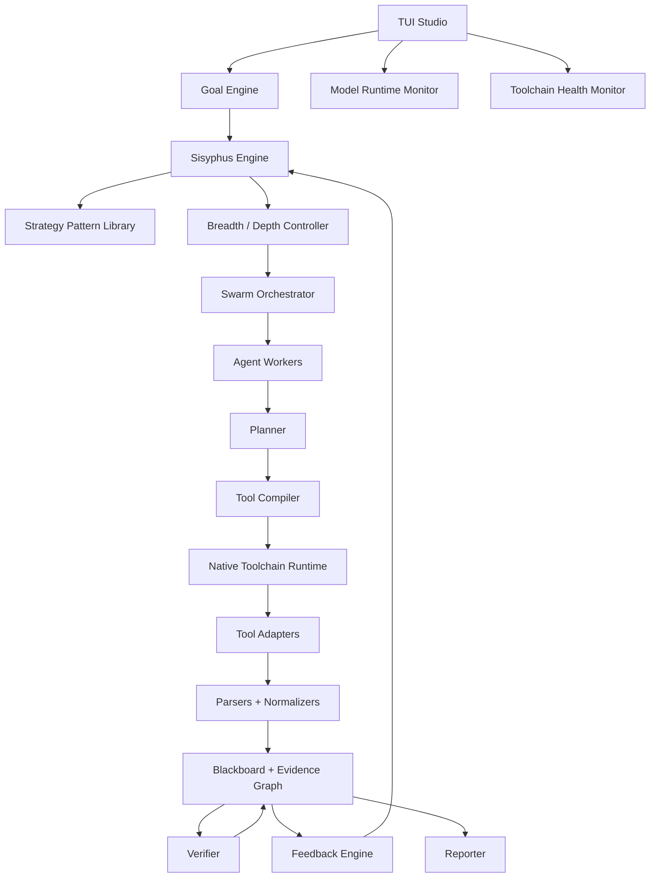

# Ouroboros 平台架构设计书

## 0. 设计立场

Ouroboros 不是 Kali-MCP、Eidolon、Xalgorix 的拼装版，也不是把安全工具全部暴露给 Agent 的 MCP 集合。它是一个 **TUI-first 的全自动化渗透测试编译器 / IDE**：用户在终端工作台里定义目标，系统持续建立世界模型、拆分任务、调度多智能体、编译工具链、执行尝试、沉淀证据、分析失败、变异策略，直到任务目标达成或高价值路径被证明耗尽。

六个参考项目只提供设计哲学：

| 来源 | 借鉴 | 不继承 |
|---|---|---|
| Kali-Security-MCP | 工具标准化、输出解析、finding 生命周期意识 | 巨大工具面、LLM 直接路由工具、多套调度器、同步执行架构 |
| Eidolon | 环境可复现、profile 分层、红队工具箱体感 | Bash 顺序编排、文件约定即数据模型、失败被隐藏 |
| Xalgorix | 事件流、运行态控制、报告体验 | WebUI 作为主入口、Prompt 驱动的自由 Agent loop |
| BreachWeave | Manager/Solver/Observer 分工、Idea/Memory 分层、TUI 运行态、timeline lanes | 比赛题目 API 绑定、Web 管理面作为主入口 |
| Cairn | Fact/Intent/Hint 黑板协议、Dispatcher 唯一写入者、bootstrap/reason/explore 三任务模型 | 无角色工作流的极简设计直接照搬 |
| aide-for-pentest | Pattern YAML、蚁群记忆、CTF overlay、内置语料工具 | 外部 core 未开源、手工 worker 组合方式 |

设计核心：**目标驱动、TUI 原生、工具内置、多智能体协同、证据图约束、广度/深度动态平衡**。

## 1. 产品形态：Ouroboros TUI Studio

Ouroboros 的主产品不是 WebUI，而是一个类似 Codex、Claude Code、opencode 和 VSCode 混合体的终端 IDE。

```text
┌──────────────────────┬──────────────────────────────────────┬──────────────────────────────┐
│ Workspace            │ Mission Conversation / Workbench      │ Attack Graph                 │
│ engagements/         │                                      │ target-service-finding graph │
│ artifacts/           │  Goal Stack                           ├──────────────────────────────┤
│ evidence/            │  Sisyphus loop                        │ Agent Graph                  │
│ attempts/            │  selected agent workbench             │ planner -> web -> verifier   │
│ findings/            │  report draft / replay                ├──────────────────────────────┤
│ reports/             │                                      │ Inspector / Runtime Panels   │
└──────────────────────┴──────────────────────────────────────┴──────────────────────────────┘
│ model:gpt-x | ctx:74% | agents:7 | breadth:62% | depth:3 chains | tools:healthy | cost:$x │
└─────────────────────────────────────────────────────────────────────────────────────────────┘
```

主界面由四个层次组成：

- 左侧 Workspace：任务目录、配置、证据、attempt、finding、报告、replay。
- 中间 Workbench：默认显示 Mission Conversation；选中 Agent 后切换为该 Agent 的工作台。
- 右侧 Graph Stack：上方 Attack Graph，中间 Agent Graph，下方 Inspector / Runtime。
- 底部 Status Bar：模型、上下文、用量、智能体、广度、深度、工具健康、运行成本。

WebUI 不作为第一版目标。报告、攻击图和 replay 可以导出为 HTML，但平台运行不依赖浏览器。

## 2. 顶层架构



核心模块：

- Goal Engine：管理任务目标栈。
- Sisyphus Engine：持续尝试、失败归因、策略变异。
- Strategy Pattern Library：保存 RalphLoop、Explore-Plan-Execute、Ant Colony 等可组合策略模式。
- Breadth / Depth Controller：决定扩面还是深挖。
- Swarm Orchestrator：调度多智能体并同步进度，同时作为核心状态唯一写入者。
- Blackboard + Evidence Graph：事实、意图、提示、证据、攻击路径和状态的唯一来源。
- Tool Compiler：把语义动作编译成工具链。
- Native Toolchain Runtime：内置、锁定、健康检查所有工具。
- Model Runtime Monitor：显示模型、用量、上下文、压缩状态。
- TUI Studio：所有运行状态的主界面。

## 3. Goal Stack

每次运行都有一个目标栈，而不是单一目标。

| 层级 | 作用 | 示例 |
|---|---|---|
| Mission Goal | 最终任务目标 | 验证高价值漏洞、拿到 flag、建立攻击路径、完成报告 |
| Coverage Goal | 防止测试过浅 | 路由、参数、认证态、服务、身份、题型、文件面 |
| Evidence Goal | 防止误判和幻觉 | 原始输出、截图、复现步骤、置信度、失败原因 |
| Report Goal | 保证可交付 | 漏洞报告、路径图、证据链、未覆盖区域、下一轮建议 |

Goal Engine 不输出具体工具名，只输出“下一轮最值得推进的问题”。

## 4. Sisyphus Engine

Sisyphus Engine 是平台的持续推进机制。

```text
Goal
-> World Model
-> Hypothesis
-> Plan
-> Attempt
-> Evidence
-> Failure Analysis
-> Strategy Mutation
-> Next Attempt
```

每一轮必须记录：

- 当前目标栈；
- 当前世界模型；
- 本轮假设；
- 本轮计划；
- 本轮工具链；
- 得到的证据；
- 失败归因；
- 下一轮变异方向。

停止不是 checklist 跑完，而是 Mission Goal 达成、高价值路径耗尽、信息不足、预算达到上限或继续尝试收益过低。

### 4.1 任务三态

Ouroboros 的持续推进使用三类基础任务，来自 Cairn 的简化模型，但会和 Goal Stack、Breadth/Depth Controller 结合：

| 任务 | 作用 | 输出 |
|---|---|---|
| `bootstrap` | 项目初始态直接尝试建立关键突破，不先过度规划 | Fact、可能的 Mission progress |
| `reason` | 读取黑板和证据图，判断目标是否达成、是否需要新 Intent | Complete / Intent / no-op |
| `explore` | 认领一个 Intent，执行探索并产出一个结论 Fact | Fact、Failure、MutationHint |

`bootstrap` 防止系统在简单目标上过度拆解；`reason` 防止无意义继续；`explore` 保证每个执行单元边界清晰。

### 4.2 Conclude Fallback

长任务超时、输出解析失败或 Agent 中断时，不应直接丢弃上下文。Ouroboros 需要 Attempt Conclude Fallback：用同一 session 或其可恢复摘要进入收尾阶段，只要求提炼已确认事实、失败原因和可复用线索，不继续推进新动作。这样失败 attempt 也能为 Evidence Graph 提供路标。

## 5. Breadth / Depth Controller

Ouroboros 不能只广撒网，也不能一发现候选点就钻到底。Breadth / Depth Controller 维护一个 Frontier Queue，用分数决定下一步扩面还是深挖。

```text
candidate path = target + hypothesis + expected unlock + cost + confidence + novelty
```

评分模型：

```text
score =
  mission_value
+ unlock_potential
+ evidence_confidence
+ novelty
- cost
- duplicate_risk
- noise
- exhausted_penalty
```

### 5.1 广度

广度由 Coverage Matrix 表达，不是简单 checklist。

```text
Web/API
routes: discovered 420 / tested 180 / verified 12 / exhausted 55
params: discovered 900 / tested 310
auth states: anonymous, user, admin, expired

Infra/Internal
hosts: 64 discovered / 42 fingerprinted
services: 180 found / 96 tested
identities: 12 observed / 4 reusable

CTF/Lab
hypotheses: 18 tried / 4 promising / 1 solved
```

TUI 中提供 Coverage Heatmap，显示哪些区域测得浅、哪些路径正在深入、哪些已被证据证明耗尽。

### 5.2 深度

深度是 Objective Chain，而不是验证一个漏洞就结束。

```text
candidate -> verified finding -> impact proof -> path extension -> mission progress
```

一个 verified finding 会触发新问题：能否解锁身份、访问新接口、暴露配置、推进内网路径、形成攻击链、派生新智能体或生成报告证据。

## 6. Agent Swarm

多智能体是平台一等能力。它不是多个 Agent 自由聊天，而是由 Swarm Orchestrator 通过 Event Log 和 Blackboard/Evidence Graph 同步。

整体分工吸收 BreachWeave 的 Manager/Solver/Observer 思想：

- Manager：对应 Swarm Orchestrator 和 Goal Engine，负责全局节奏、资源、状态写入。
- Solver：对应各类 Agent Worker，负责具体路径探索。
- Observer：对应 Context Agent、Graph Agent 和运行态监督逻辑，负责纠偏、压缩、发现停滞和上下文降噪。

内置角色：

- Planner Agent：拆 Goal Stack，生成任务图。
- Web/API Agent：负责 Web/API 能力包。
- Infra Agent：负责主机、服务、身份和路径图。
- CTF Agent：负责题型识别、分析和解题路径。
- Verifier Agent：验证候选 finding。
- Evidence Agent：整理证据、去重、补全复现材料。
- Reporter Agent：把证据图投影成报告。
- Context Agent：维护摘要、压缩上下文、保留关键引用。
- Graph Agent：分析 Attack Graph 的缺口和下一跳。

### 6.1 Swarm Orchestrator

Swarm Orchestrator 负责：

- 分配子目标；
- 维护 Agent 生命周期；
- 控制并发；
- 汇总进度；
- 处理阻塞；
- 合并证据；
- 去重 finding；
- 防止重复路径；
- 校验 Agent 结构化输出；
- 作为唯一写入者把 Agent 输出写回 Blackboard/Evidence Graph；
- 触发 Sisyphus Engine 下一轮变异。

### 6.2 Agent Graph

Agent Graph 显示智能体依赖、进度和状态。

```text
planner   running  78%  split mission into 9 paths
web-api   running  61%  testing auth-state routes
infra     blocked  44%  waiting reusable credential
verifier  queued   12 findings
reporter  idle
```

聚焦或悬停节点时显示：Agent 名称、role、当前子目标、当前 hypothesis、attempt、进度、token/cost、上下文占用、最近事件、阻塞原因、产出证据数和 finding 数。

中间 Workbench 默认显示总控对话；选中某个 Agent 后显示该 Agent 的工作台。终端支持鼠标时启用 hover；不支持时用键盘焦点实现同样能力。

## 7. Blackboard Protocol 与 Evidence Graph

Evidence Graph 是平台事实层。Blackboard Protocol 是多智能体协作层。状态推进只能由证据事件触发，不能由模型自述触发。

### 7.1 Fact / Intent / Hint

Ouroboros 的黑板协议采用三种协作对象：

| 对象 | 含义 | 约束 |
|---|---|---|
| Fact | 已确认的客观事实，是图中的稳定节点 | 只增不改；大输出只记录摘要和 artifact 引用 |
| Intent | 从一个或多个 Fact 出发的探索意图，是未完成或已完成的探索边 | 可认领、心跳、释放、结论化 |
| Hint | 人或系统注入的策略提示、态势判断、阶段性建议 | 不参与因果证明，但会影响下一轮 reason |

Swarm Orchestrator 是协议唯一写入者。Agent 只能返回结构化候选输出，由 Orchestrator 校验后写入 Fact、Intent、Hint、Attempt 或 Finding。

Intent 支持超边：一次探索可以由多个 Fact 共同支撑。这样可以表达“凭证 + 服务 + 网络位置”共同解锁下一步，而不是强行选择一个主因。

### 7.2 Evidence Graph 节点

核心节点：

- `Target`：URL、Host、CIDR、Domain、API、Binary、Container、Challenge
- `Surface`：端口、服务、路由、参数、表单、认证态、文件、协议
- `Identity`：账号、角色、token、session、credential material
- `Artifact`：响应、截图、日志、pcap、二进制、字典、报告片段
- `Finding`：候选、已佐证、验证中、已验证、可利用、已报告
- `Attempt`：计划、工具链、参数、运行环境、开始/结束、失败原因
- `Hypothesis`：可测试假设、依赖证据、预期结果、实际结果
- `Agent`：角色、任务、上下文、状态、产物

核心边：

- `observed_by`
- `supports`
- `contradicts`
- `derived_from`
- `verified_by`
- `requires`
- `unlocks`
- `exhausted_by`
- `assigned_to`
- `produced_by`

目标状态从 `unknown` 推进到 `discovered`、`fingerprinted`、`enumerated`、`candidate_found`、`verified`、`path_built`、`reported`。

### 7.3 Timeline Lanes

TUI replay 和运行视图按 lane 展示事件：

- `mission`：目标、策略、用户输入；
- `agent`：Solver/Agent 消息、工具调用、阶段变化；
- `observer`：纠偏、压缩、停滞提醒；
- `blackboard`：Fact、Intent、Hint、Memory、Idea 变化；
- `toolchain`：工具健康、执行、parser；
- `submission/report`：提交、报告、证据输出。

这避免所有日志混成一条聊天流。

## 8. Tool Compiler

Tool Compiler 把语义动作编译成工具链。Agent 不选择具体工具，只表达目标、假设和约束。

编译输入：

- Goal Stack；
- Evidence Graph 子图；
- Domain Pack 能力树；
- Frontier Queue；
- 可用工具能力；
- 资源预算；
- 历史成功率和失败模式；
- 目标类型和当前状态。

编译输出：

- `PlanGraph`：阶段、依赖、并发关系、重试策略；
- `AttemptSpec`：工具链、输入、运行环境、期望证据；
- `ParserSpec`：如何把输出归一化为证据事件；
- `MutationHint`：失败后如何变异。

工具适配器只声明能力：

```yaml
capability: web.content_discovery
inputs: [url, auth_state, wordlist_profile]
outputs: [route, status_code, response_hash, evidence_ref]
cost: medium
noise: medium
parser: route_observation
```

## 9. Native Toolchain Runtime

所有涉及的工具应原生集成在 Ouroboros 底层。用户不需要手动安装 `nmap`、`httpx`、`nuclei`、`ffuf`、浏览器驱动、调试器、反编译器、字典或 parser。

Native Toolchain Runtime 提供：

- 内置工具包；
- 版本锁定；
- 平台适配；
- 启动自检；
- 自动更新；
- 离线 bundle；
- 工具健康检查；
- 工具能力 manifest；
- 运行隔离；
- 输出 parser 绑定；
- 字典和模板资产管理。
- 原生语料工具，例如模板库、payload 库、字典库、知识片段的 search/read 能力。

工具包分层：

- `web-api-pack`
- `infra-pack`
- `ctf-pack`
- `browser-pack`
- `report-pack`
- `wordlist-pack`
- `parser-pack`
- `corpus-pack`

每个 pack 有自己的 lock manifest：

```yaml
tool: httpx
version: 1.x
capabilities:
  - web.fingerprint
  - web.probe
runner: native
parser: http_probe_parser
healthcheck: built_in
```

TUI 中显示 Toolchain Health：

```text
Toolchain: healthy
web-api-pack: 42 tools ready
infra-pack: 37 tools ready
ctf-pack: 29 tools ready
missing: 0
updates: 3 available
```

### 9.1 Native Corpus Tools

语料、模板和字典不应要求 Agent 记路径。底层提供语义化 corpus tool：

```yaml
capability: corpus.search
inputs: [corpus_name, query, path_filter, max_results]
outputs: [artifact_ref, snippet, confidence]
runner: native
parser: corpus_search_parser
```

例如 nuclei 模板搜索、payload 模板检索、CTF 题型知识、弱口令字典、协议速查，都应通过 `corpus.search/read` 能力进入 Tool Compiler。

## 10. Model Runtime Monitor

Ouroboros 必须显示模型状态、用量和上下文窗口。模型运行时是长任务的资源仪表盘。

底部状态栏摘要：

```text
model:gpt-x | ctx:148k/200k 74% | in/out:1.2M/94k | agents:7 | cost:$x
```

Model Runtime Panel 显示：

- 当前 provider / model；
- 当前 role：planner、verifier、summarizer、reporter、domain-agent；
- context window：已用、剩余、百分比；
- token usage：input、output、cache read/write；
- cost / budget；
- 本轮调用耗时、失败率、重试次数；
- 最近一次压缩摘要时间；
- 当前上下文保留对象：Goal、Scope、Evidence Graph slice、active hypotheses、open attempts；
- 是否接近上下文溢出。

Context Health：

```text
Context: 148k / 200k  74%
Health: ok
Pinned: mission, scope, active graph, verified findings
Will compact at: 85%
Risk: low
```

默认阈值：

- `70%`：开始 rolling summary；
- `85%`：压缩历史 attempt，只保留证据引用；
- `95%`：checkpoint 当前推理链，暂停新假设生成；
- 接近上限：必须 compact 或切换模型。

多模型分工也要可见：

```text
Planner:    gpt-5-high
Verifier:   rules + gpt-5-mini
Summarizer: small-fast-model
Reporter:   gpt-5
Embedding:  text-embedding-x
```

## 11. TUI Panels 与交互

### 11.1 Workspace

Workspace 像 VSCode Explorer，但面向渗透测试任务：

```text
mission.yaml
scope.yaml
artifacts/
evidence/
attempts/
findings/
reports/
replay/
toolchain/
```

### 11.2 Mission Conversation

主对话不是普通聊天，而是任务中枢：展示 Goal Stack、当前 Sisyphus 轮次、计划、执行结果、失败归因、策略变异和用户插话。

### 11.3 Attack Graph

Attack Graph 展示 Target、Surface、Identity、Artifact、Finding、Attempt、Hypothesis 的事实图，像 Obsidian 知识图谱的终端版本。节点可聚焦，边可过滤。

### 11.4 Agent Workbench

选中 Agent Graph 节点后，中间主页面切换为该 Agent 的工作台，显示它的任务目标、上下文、当前 attempt、输出证据和阻塞原因。

### 11.5 Runtime Tabs

右下 Inspector 支持标签：

- Node Inspector
- Model Runtime
- Agent Runtime
- Toolchain Health
- Coverage Matrix
- Frontier Queue
- Timeline Lanes

### 11.6 快捷键

```text
Ctrl+P  Command Palette
Tab     切换主面板
/       搜索文件、证据、节点、finding
g       聚焦 Attack Graph
a       聚焦 Agent Graph
Enter   打开节点或 Agent Workbench
Esc     回到 Mission Conversation
1-9     快速切换 Agent
?       快捷键帮助
```

## 12. Domain Packs

Domain Pack 是领域知识包，不是独立系统。它们共享 core、Tool Compiler、Evidence Graph 和 Native Toolchain Runtime。

每个 Domain Pack 可以绑定 Strategy Patterns，例如：

- `ralphloop`：持续重试直到评估通过；
- `explore_plan_execute`：先探索、再计划、再执行；
- `ant_colony`：多 Agent 并行探索，用共享记忆沉淀强路径和死路。

### 12.1 Web/API Pack

能力面：站点发现、爬取、接口识别、OpenAPI/GraphQL/schema 解析、认证态建模、会话保持、参数推断、内容发现、访问控制测试、输入验证类候选、服务端请求类候选、文件处理类候选、配置泄露、业务流程建模、浏览器自动化、证据复现和报告映射。

关键是维护认证态、业务上下文和请求变体，而不是只跑模板。

### 12.2 Infra/Internal Pack

能力面：资产发现、端口服务枚举、版本与协议指纹、服务关系建模、凭证面分析、身份与权限图、关键服务识别、路径枚举、弱配置候选、横向路径假设、网络段增量扫描、证据聚合和攻击路径报告。

核心是图推理：单个服务发现不够，真正价值来自身份、服务、网络位置和配置组合能否推进 Mission Goal。

### 12.3 CTF/Lab Pack

能力面：题型识别、附件归类、静态分析、动态运行观察、输入输出行为建模、约束求解、模糊探索、符号线索提取、Web/二进制/逆向/密码/misc 子策略切换、候选解验证和 flag/证明提取。

核心是快速假设变异，同时记录每轮假设、输入、输出和失败原因，避免重复撞墙。

## 13. 数据与存储

运行时使用事件日志和图状态双轨：

- Event Log：不可变事件，记录 goal、hypothesis、attempt、agent event、tool result、parser output、verification、mutation。
- Blackboard Store：Fact、Intent、Hint、lease、heartbeat、claim、conclude 记录。
- Evidence Graph：当前世界模型，可从事件日志和黑板重建。
- Artifact Vault：content-addressed 存储响应、截图、日志、二进制、报告片段。
- Snapshot：目标状态、覆盖矩阵、finding 生命周期、资源消耗、模型用量。
- Replay Store：重放 TUI 事件、Agent 事件和推理链。

SQLite + WAL 作为单机第一版默认存储；图结构先用关系表表达，后续可替换为专用图存储。关键要求是可重放：`ouro replay <run_id>` 应能重建当时的推理链和 TUI 状态。

## 14. 技术选型

| 组件 | 选型 | 原因 |
|---|---|---|
| Core | Go | 并发、单二进制、进程控制、终端 UI 后端都稳 |
| TUI | Bubble Tea + Lip Gloss + Bubbles | 适合复杂终端 IDE、状态流和快捷键 |
| Graph Renderer | TUI graph renderer + 可导出 HTML | 运行时在终端，复盘时可导出 |
| Event Log | SQLite WAL | 单机低运维、可恢复、可查询、可重放 |
| Artifact Vault | 文件系统 + hash index | 大文件不进 DB，证据可去重 |
| Toolchain | Native bundle + manifest lock | 用户不手动装工具，能力可复现 |
| Tool Adapter | 声明式 capability manifest + runner | 工具多但不暴露给 Agent |
| Strategy Patterns | YAML/JSON graph pattern + runtime evaluator | RalphLoop、EPE、Ant Colony 等策略可配置、可复用 |
| Planner | 原生规则 + LLM 辅助候选生成 | 避免 prompt 承担平台职责 |
| Model Runtime | provider adapter + usage ledger | 模型、上下文、用量必须可观测 |
| 配置 | YAML + schema 校验 | 可读、可版本化、开跑前能验证 |

## 15. 施工顺序

1. 建立 core schema：Goal Stack、Blackboard Protocol、Evidence Graph、Event Log、Artifact Vault、Attempt/Finding/Hypothesis/Agent。
2. 实现 TUI Studio 骨架：Workspace、Mission Conversation、Status Bar、Inspector。
3. 实现 Sisyphus Engine 最小闭环：bootstrap、reason、explore、conclude fallback。
4. 实现 Breadth / Depth Controller：Frontier Queue、Coverage Matrix、Objective Chain。
5. 实现 Agent Swarm：Swarm Orchestrator、Agent Graph、Agent Workbench、进度同步、唯一状态写入。
6. 实现 Model Runtime Monitor：模型、上下文、用量、成本、压缩状态。
7. 实现 Native Toolchain Runtime：内置 bundle、manifest lock、healthcheck、parser 绑定、corpus tool。
8. 实现 Strategy Pattern Library：RalphLoop、Explore-Plan-Execute、Ant Colony。
9. 实现 Tool Compiler 和 Adapter SDK：语义动作到工具链，parser 输出到证据事件。
10. 实现 Web/API Pack 第一条完整闭环。
11. 实现 Infra/Internal Pack 第一条完整闭环。
12. 实现 CTF/Lab Pack 第一条完整闭环。
13. 增强 Replay、报告导出、攻击图导出和长期运行恢复。

## 16. 非目标

- 不把 Kali-MCP 的工具注册表作为运行时核心。
- 不把 Eidolon 的 Bash 流水线作为编排核心。
- 不把 Xalgorix 的 WebUI 作为主产品入口。
- 不把“工具数量”当作平台能力指标。
- 不让 LLM 直接推进事实状态。
- 不要求用户手动安装底层工具链。
- 不在架构层把 Web/API、Infra/Internal、CTF/Lab 做成三套系统。
